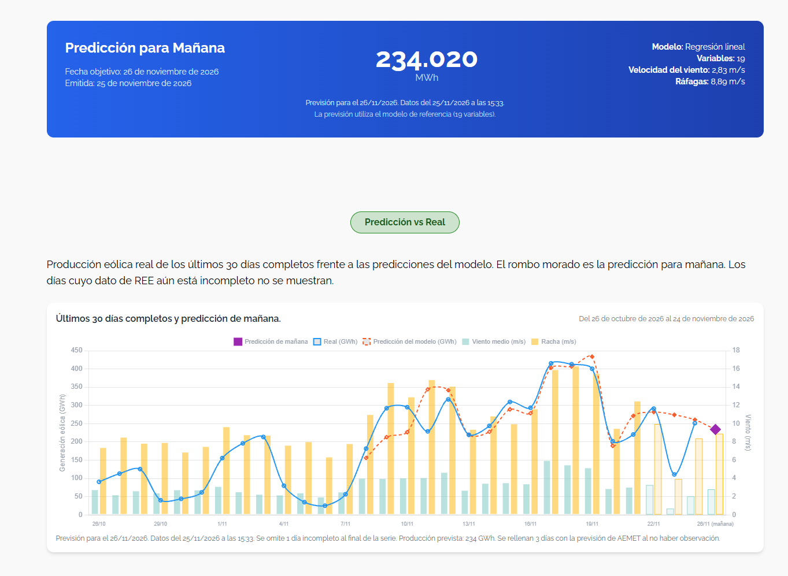

# Proyecto ML — Predicción de Generación Eólica Peninsular



Web en producción: [Aero Predictor](https://aero-predictor.joseluisalonsoredondo.es/resultados)

## Descripción

Este proyecto construye un modelo de Machine Learning capaz de predecir la generación diaria de energía eólica en la España peninsular, combinando datos históricos de producción de la Red Eléctrica de España (REE) con datos meteorológicos de la Agencia Estatal de Meteorología (AEMET).

El sistema incluye también un backend FastAPI que sirve el modelo entrenado como una API REST, y un frontend web que muestra la predicción del día siguiente junto con la producción real de los últimos días. Cada día, un workflow de GitHub Actions pide al backend el snapshot de la previsión (a las 05:17 y a las 08:17, hora de Madrid) y lo publica en el repositorio.

---

## Estructura del Proyecto

```
proyecto_ML_Renovables/
├── src/
│   ├── notebooks/main.ipynb   # descarga, EDA, interpolación, features, entrenamiento y serialización
│   └── data/                  # base de datos de análisis y copia del modelo
├── backend/
│   ├── app/main.py            # FastAPI y scheduler
│   ├── app/api/               # endpoints de predicción y gráficas
│   ├── app/services/          # clientes de REE y AEMET, base de datos y carga del modelo
│   ├── data/ree_generacion.db # base de datos que usa el backend
│   ├── modelos/lr_eolica.joblib
│   └── requirements.txt
├── frontend/                  # interfaz web (Astro, Tailwind, Chart.js, Leaflet)
├── modelos/lr_eolica.joblib   # modelo de producción serializado (Linear Regression + scaler)
├── .github/workflows/forecast-refresh.yml  # actualización diaria del snapshot
└── render.yaml                # despliegue del backend en Render
```

---

## Flujo del Notebook (`src/notebooks/main.ipynb`)

### 1. Adquisición de datos — REE

Se descarga la estructura de generación eléctrica diaria desde la API pública de REE (`apidatos.ree.es`) desde enero de 2022 hasta la fecha actual.

- **Tecnologías capturadas:** Eólica, Solar fotovoltaica, Solar térmica, Hidráulica, Hidroeólica, otras renovables y no renovables.
- Los datos se almacenan en una tabla SQLite (`generacion`) con clave primaria `(datetime, tecnologia)` para evitar duplicados.
- La descarga se realiza en tramos de 30 días para evitar timeouts.

### 2. Adquisición de datos — AEMET

Se descargan datos climáticos diarios de estaciones meteorológicas próximas a los principales parques de generación renovable de España:

| Tipo | Parques / Zonas | Variables descargadas |
|------|-----------------|----------------------|
| Eólica | Andevalo (Huelva), Gecama (Cuenca), Maranchón (Guadalajara), Borja (Zaragoza), Tarifa (Cádiz), Briviesca (Burgos), La Muela (Zaragoza) | `velmedia`, `racha` |
| Fotovoltaica | Francisco Pizarro y Núñez de Balboa (Badajoz), Mula (Murcia), Don Rodrigo (Sevilla), Chiprana (Zaragoza) | `tmed`, `tmin`, `tmax`, `sol` |
| Hidráulica | La Muela (Valencia), Aldeadávila (Salamanca), Brozas (Cáceres) | `prec` |

Los datos se almacenan en la tabla `aemet_diario` con clave primaria `(fecha, indicativo)`.

### 3. Análisis de calidad y decisión de alcance

Se realizó un diagnóstico de nulos y cobertura temporal por estación:

- **Solar fotovoltaica descartada:** 3 de 5 estaciones no tienen datos de insolación (`sol`), y otra supera el 50% de nulos. Sin insolación no es viable predecir generación fotovoltaica.
- **Hidráulica descartada:** los datos de precipitación local no representan el caudal real, que depende de toda la cuenca hidrográfica.
- ✅ **Se selecciona la energía eólica** como objetivo del modelo, ya que las 6 estaciones disponen de datos de velocidad media y racha con buena cobertura.

### 4. Preprocesamiento y relleno de valores nulos

Se evaluaron seis métodos de interpolación mediante validación hold-out (enmascarando el 15% de los valores conocidos):

| Método | Descripción |
|--------|-------------|
| Forward Fill | Propaga el último valor conocido |
| Backward Fill | Propaga el siguiente valor conocido |
| **Linear Interpolation** ✅ | **Mejor resultado global** |
| Cubic Interpolation | Interpolación cúbica |
| KNN Mean (n=8) | Media de los 8 vecinos más próximos |
| Seasonal Mean | Media estacional (ventana anual) |

**Conclusión:** La **interpolación lineal** obtuvo el menor RMSE en la mayoría de estaciones y fue seleccionada para rellenar los huecos en `velmedia` y `racha`.

Tras interpolar, se calculó la **media diaria** de todas las estaciones eólicas, generando un único valor representativo nacional para cada día.

### 5. Feature Engineering

El dataset final de entrada al modelo incluye las siguientes características construidas sobre `df_eolica`:

| Feature | Descripción |
|---------|-------------|
| `velmedia` | Velocidad media del viento (m/s) |
| `racha` | Racha máxima del viento (m/s) |
| `mes` | Mes del año (1–12) — estacionalidad |
| `dia_semana` | Día de la semana (0–6) |
| `dia_año` | Día del año (1–365) |
| `eolica_lag1/2/3/7` | Generación eólica de los días anteriores |
| `vel_ma3/7/14` | Media móvil de velocidad (3, 7 y 14 días) |
| `racha_ma3/7/14` | Media móvil de racha (3, 7 y 14 días) |
| `eolica_ma7` | Media móvil del target con shift (sin data leakage) |
| `sol_lag1` | Horas de sol del día anterior al objetivo (observación; si no existe, previsión de AEMET o, como último recurso, media de los 7 días anteriores marcada como estimada) |
| `tmed_lag1` | Temperatura media del día anterior al objetivo |
| `eolica_prev` | Previsión de generación eólica peninsular de REE para el día objetivo |

El modelo de producción usa 19 variables: las 16 anteriores y las tres últimas de la tabla (`sol_lag1`, `tmed_lag1` y `eolica_prev`), que se calculan en el pipeline de predicción diaria del backend.

### 6. Entrenamiento y evaluación de modelos

División temporal **80 % train / 20 % test** (sin mezcla aleatoria, respetando el orden cronológico).

Se entrenaron los siguientes modelos:

| Modelo | Notas |
|--------|-------|
| Linear Regression | Con StandardScaler |
| Ridge (α=10) | Regularización L2 |
| Lasso (α=0.1) | Regularización L1 |
| Random Forest | 300 estimadores, max_depth=12 |
| XGBoost | 400 estimadores, lr=0.05 |
| LightGBM | 400 estimadores, lr=0.05 |
| Red Neuronal (MLP) | Capas (128, 64, 32), early stopping |
| SARIMAX(1,0,1)(1,1,1,7) | Serie temporal con exógenas velmedia + racha |

**Métricas de evaluación:** RMSE (MWh), MAE (MWh), R², MAPE (%), Accuracy% (quintiles).

**Modelo de producción** (Linear Regression, 19 variables, periodo de test del acta `backend/modelos/familia_como_modelo.json`): RMSE 23.108 MWh · MAE 15.588 MWh · R² 0,9308.

### 7. Pronóstico para el día siguiente

Cada día, el backend construye el vector de 19 variables para el día objetivo con:

- la previsión de AEMET para las 12 ubicaciones de las estaciones eólicas y su agregado nacional,
- las observaciones de los días anteriores (viento, racha, sol y temperatura),
- la previsión de REE para la península (`eolica_prev`).

Si falta alguna variable, el backend no emite la predicción en lugar de usar un valor inventado. Las previsiones se guardan en un archivo durable dentro del snapshot para poder recalcular la predicción tras un reinicio.

### 8. Serialización del modelo

El modelo seleccionado (**Linear Regression**) junto con su scaler y la lista de features se serializa con `joblib` en `modelos/lr_eolica.joblib` como un diccionario `{modelo, scaler, features}`. El backend usa su propia copia en `backend/modelos/`.

---

## Backend, frontend y despliegue

- **Backend:** FastAPI desplegado en Render (`render.yaml`). Expone `/health`, `/api/prediction`, `/api/prediction-chart` y el endpoint interno que genera el snapshot. El disco de Render no es persistente, así que tras un reinicio el backend restaura las previsiones desde el último snapshot publicado.
- **Frontend:** Astro desplegado en Vercel. Lee el snapshot `frontend/src/data/forecast-snapshot.json` en el momento de compilar; el navegador no llama al backend.
- **Actualización diaria:** el workflow `forecast-refresh.yml` comprueba si el snapshot ya es el de mañana, pide uno nuevo al backend, lo valida y lo publica con un commit `data: snapshot de previsión para AAAA-MM-DD`.
- **Reentrenamiento:** el proceso diario no reentrena el modelo. Para actualizarlo hay que ejecutar el notebook y sustituir también la copia de `backend/modelos/`.

---

## Conclusiones

1. **Foco en eólica:** La falta de datos fiables de insolación en las estaciones cercanas a plantas fotovoltaicas, y la baja correlación entre precipitación local y generación hidráulica, llevaron a centrar el proyecto exclusivamente en la predicción de generación eólica.

2. **Interpolación lineal:** Es el método más robusto para rellenar los huecos temporales de las variables de viento, con menor RMSE frente a métodos más complejos como la interpolación cúbica o la media estacional.

3. **Correlación viento–eólica:** Se observa una correlación clara y consistente entre la velocidad media del viento (y la racha) y la generación eólica nacional, visible tanto en series temporales como en el heatmap de correlaciones.

4. **Modelo seleccionado:** Linear Regression ofrece un buen equilibrio entre interpretabilidad y rendimiento predictivo, siendo seleccionado como modelo de producción. Los modelos de boosting (XGBoost, LightGBM) y el SARIMAX también ofrecen resultados competitivos.

5. **Predicción diaria:** Gracias a las previsiones de AEMET y REE es posible obtener cada día la predicción de generación eólica para el día siguiente y publicarla en la web, cerrando así el ciclo completo desde los datos hasta la predicción.

---

## Tecnologías utilizadas

- **Python 3.x**
- `pandas`, `numpy`, `scipy` — manipulación y análisis de datos
- `scikit-learn` — preprocesamiento, modelos clásicos y red neuronal MLP
- `xgboost`, `lightgbm` — gradient boosting
- `statsmodels` — SARIMAX
- `matplotlib`, `seaborn` — visualización
- `requests`, `python-dotenv` — consumo de APIs REST
- `sqlite3` — almacenamiento local de datos
- `joblib` — serialización del modelo
- `FastAPI`, `uvicorn` — backend de la API REST
- `Astro`, `Tailwind CSS`, `Chart.js`, `Leaflet` — frontend
- `Render` (backend), `Vercel` (frontend) y `GitHub Actions` (actualización diaria)

---

## Configuración

1. Crea `backend/.env` a partir de `backend/.env.example` con tus claves de AEMET y REE (`AEMET_API_KEY`, `REE_API_KEY`). No subas `.env` al repositorio.

2. Instala y arranca el backend:

```bash
cd backend
pip install -r requirements.txt
uvicorn app.main:app --reload
```

Comprueba que responde en `http://localhost:8000/health`.

3. Instala y arranca el frontend:

```bash
cd frontend
npm install
npm run dev
```

Por defecto usa `http://localhost:8000` como API; para cambiarla, define `PUBLIC_API_URL` en `frontend/.env` (ver `frontend/.env.example`).

4. Para reentrenar el modelo, ejecuta `src/notebooks/main.ipynb` de principio a fin, que escribe el `.joblib` en `modelos/`, y actualiza también la copia de `backend/modelos/`.

5. Pruebas:

```bash
node --test backend/tests
node --test frontend/tests
```
